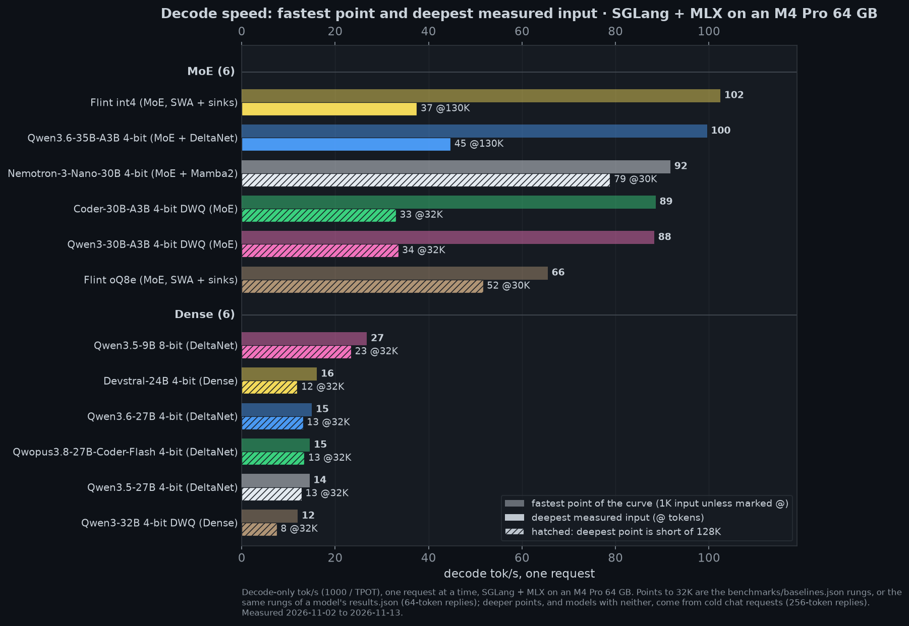
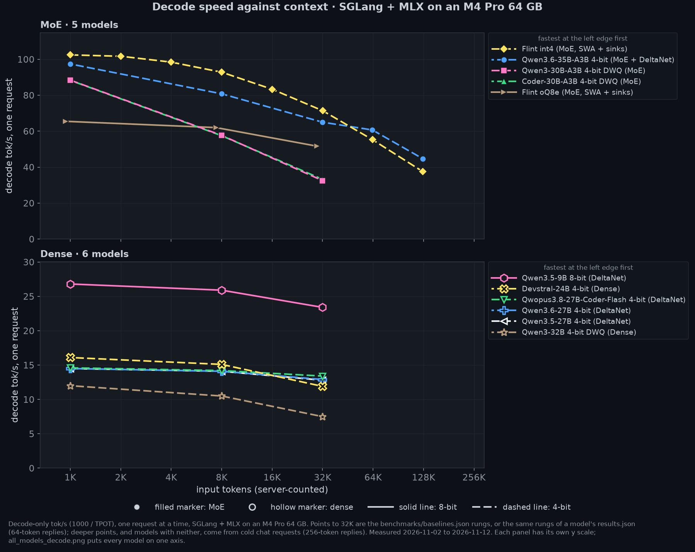

# Apple Silicon Inference: SGLang + MLX on M4 Pro

Long-context LLM inference on an Apple M4 Pro Mac mini (64 GB unified memory) with SGLang's
native MLX backend: **SGLang v0.5.23** (`297e54f`) + 31 patches ([patches/README.md](patches/README.md)).
The target workload is single-user agentic coding at long context (tool-call-heavy multi-turn
sessions over 10K–100K-token codebase prefixes), where decode speed at depth matters more
than peak batch throughput. Known issues are
[GitHub issues](https://github.com/mattbucci/m4-sglang-inference/issues?q=is%3Aissue+is%3Aopen+label%3Aknown-issue)
with the `known-issue` label; experiment specs and open work live in
[experiments/README.md](experiments/README.md).

## Results

**`qwen36`** (Qwen3.6-35B-A3B MoE+DeltaNet+VL) is the primary model: codegen, vision and
video STRONG, thinking VERIFIED, and a 256K single-user context validated with 6/6
multi-needle recall at every rung to 245K realized tokens ([docs/long-context.md](docs/long-context.md)).

### Decode at genuine depth

Single user, 64 output tokens, server-verified depth (`actual_input_tokens` == label), served
with `CTX=36000 MEM_FRAC=0.45 SGLANG_MLX_CACHE_LIMIT_GB=2 --disable-radix-cache`. These rows
are the regression baselines (`benchmarks/baselines.json`; `scripts/bench/bench_regression.sh <preset>`
compares a live server against them).

| Preset | Checkpoint (mlx-community) | Type | Wts | tok/s @1K / 8K / 32K | TTFT @32K | Context |
|--------|---------------------------|------|:---:|:--------------------:|:---------:|:--------|
| `qwen36` | `Qwen3.6-35B-A3B-4bit` | MoE+DeltaNet+VL | 17 GB | 97.4 / 80.8 / 65.0 | 56 s | **256K validated** |
| `coder-30b` | `Qwen3-Coder-30B-A3B-Instruct-4bit-DWQ` | MoE (3B active) | 16 GB | 81.9 / 55.2 / 32.0 | 97 s | 32K measured, 256K label |
| `qwen3-moe` | `Qwen3-30B-A3B-4bit-DWQ` | MoE (3B active) | 16 GB | 81.9 / 55.1 / 31.8 | 100 s | 32K measured, 256K label |
| `qwen35-9b-8bit` | `Qwen3.5-9B-MLX-8bit` | DeltaNet hybrid+VL | 10 GB | 26.8 / 25.9 / 23.4 | 100 s | 32K measured |
| `devstral` | `Devstral-Small-2-24B-Instruct-2512-4bit` | Dense+VL (Mistral3) | 14 GB | 16.1 / 15.1 / 11.9 | 282 s | 32K measured |
| `qwen35` | `Qwen3.5-27B-4bit` | DeltaNet hybrid+VL | 15 GB | 14.5 / 14.1 / 12.8 | 310 s | 32K measured, 256K label |
| `qwen36-27b` | `Qwen3.6-27B-4bit` | DeltaNet hybrid+VL | 14 GB | 14.5 / 14.1 / 12.9 | 301 s | 32K measured, 256K label |
| `qwen36-27b` + `MODEL=…/Qwen3.8-27B-4bit` | `Qwen3.8-27B-4bit` | DeltaNet hybrid+VL | 15 GB | 14.1 @1K | — | 131K served (SWE-bench) |
| `qwen36-27b` + `MODEL=mattbucci/Qwopus3.8-27B-Coder-Flash-MLX-4bit` | `Qwopus3.8-27B-Coder-Flash-MLX-4bit` (in-house build, published) | DeltaNet hybrid+VL | 15 GB | 14.6 / 14.2 / 13.2 | 302 s | 32K measured, 131K served (SWE-bench) |
| `flint` | `flint-oQ8e` (`MODEL=RecursiveSI/flint-int4` for the fast 4-bit) | MoE 40B-A2.5B, SWA + sinks | 42 GB | 65.5 / 62.0 / 51.7 (int4: 101.9 / 93.2 / 72.3) | 54 s | 32K preset, 128K measured, 262K label |
| `qwen3-32b` | `Qwen3-32B-4bit-DWQ` | Dense | 18 GB | 12.0 / 10.5 / 7.5† | 494 s | 32K at `MEM_FRAC=0.5` |
| `nemotron-30b` | `NVIDIA-Nemotron-3-Nano-30B-A3B-4bit` | NemotronH (Mamba2+Attn+MoE) | 17 GB | — | — | 32K probe |

† The 0.45 pool caps `qwen3-32b` requests at 25,241 tokens, so its 32K point is served at
`MEM_FRAC=0.5`. **DeltaNet holds decode flat at depth** (the hybrids retain 85–88% of their
short-context speed at 32K) while full-attention models halve or worse. Full curves (128→32K,
9 points): `benchmarks/<slug>/results.json`; regression receipts:
`benchmarks/regression/`. Flint checkpoints, the published M4 Pro engine targets and tool-call
behaviour: [docs/flint.md](docs/flint.md).





[`generate_charts.py`](scripts/bench/generate_charts.py) draws these rows plus the cold receipts
for deeper input; a hatched bar stops short of 128K.

### Probe matrix (radix on)

| Preset | codegen | vision | video | thinking |
|--------|:-------:|:------:|:-----:|:--------:|
| `qwen36` | **STRONG** | **STRONG** | **STRONG** | **VERIFIED** |
| `qwen36-27b` (Qwen3.6-27B) | **STRONG** | **STRONG** | **STRONG** | **VERIFIED** |
| `qwen36-27b` + `MODEL=mlx-community/Qwen3.8-27B-4bit` | **STRONG** | **STRONG** | **STRONG** | **VERIFIED** |
| `qwen36-27b` + `MODEL=mattbucci/Qwopus3.8-27B-Coder-Flash-MLX-4bit` | **STRONG** | **STRONG** | **STRONG** | **VERIFIED** |
| `qwen35` | **STRONG** | **STRONG** | PARTIAL | **VERIFIED** |
| `qwen35-9b-8bit` | **STRONG** | **STRONG** | **STRONG** | pass validate gate |
| `devstral` | **STRONG** | **STRONG** | PARTIAL | n/a |
| `nemotron-30b` | **STRONG** | n/a | n/a | **VERIFIED** |
| `flint` (oQ8e / oQ6e / oQ4e / int4) | **STRONG** | n/a | n/a | **VERIFIED** |
| `coder-30b` / `qwen3-moe` / `qwen3-32b` | **STRONG** | n/a | n/a | pass validate gate |

Per-preset JSON: [`benchmarks/quality/probe-trio/`](benchmarks/quality/probe-trio/). Qwen3.8-27B,
Qwopus3.8-27B-Coder-Flash, Qwen3.6-27B and Qwen3.5-9B-8bit chat templates ignore `enable_thinking` (thinking always on).
Static scores (MMLU, HumanEval, LAB-Bench, needle), checkpoint audits and the in-house 4-bit
builds: [docs/quality.md](docs/quality.md).

### Agentic coding (SWE-bench Lite)

**`qwen36` is the only configuration that completes the agentic loop on M4 reproducibly
across all 12 ecosystems in the 26-instance test set.**

- **Patch engagement 26/26** (`evals/swebench/runs/qwen36-26inst-p023-2026-10-31/`): a
  non-empty patch targeting the canonical issue file on every instance.
- **Resolved 9/26 = 34.6%** on the official Docker harness, scored on the 3090 rig
  ([`exports/qwen36-docker-summary.json`](evals/swebench/exports/qwen36-docker-summary.json));
  above the 14–30% band typical of ~30B models on SWE-bench Lite.
- **Harness:** one scaffold lane, omp (oh-my-pi) 18.12.2, the 3090's pin; the 3090's
  scaffold bake-off puts every opencode / pi-family pair within noise (McNemar ties on 300
  isolated instances), so harness variants are not a lever. The M4 validation cell agrees:
  qwen36 under omp engages 26/26 with 25 patches on the file the opencode cell patched, 0
  timeouts, 99 min against 87, and the local scorer resolves 6/26 against 5/26 for the
  opencode lane (`evals/swebench/runs/qwen36-26inst-omp-2026-11-08/`). The omp cell on
  the 25-patch tree (`evals/swebench/runs/qwen36-26inst-omp-p033-2026-11-11/`): 26/26, local
  scorer 5/26, 89 min, served decode 62 tok/s pooled over 1092 turns. opencode
  stays selectable (`SCAFFOLD=opencode`) to reproduce the archived cells, which ran on it.
- **Sealed harness:** web tools off, the scaffold and its bash children under a localhost-only
  network sandbox, ancestor-only checkout (no branch, tag or commit past the base commit);
  `evals/swebench/audit_rollouts.py` scans the archive for leak channels, and no scored
  prediction came from a session that saw the fix. Under the seal Qwen3.8-27B writes the
  upstream change on all three smoke instances in 4–8 min each, the Qwopus3.8-27B-Coder-Flash
  build patches the same three (two the upstream change, one its regex half;
  `evals/swebench/runs/qwopus38-27b-coder-flash-sealed-131k-2026-11-02/`), and Flint bash-only
  at 64K engages 5/26 with every instance at the 1800 s cap
  ([evals/swebench/README.md](evals/swebench/README.md)).
- **Dense 27B comparators on the same 26 instances, sealed, 1800 s cap:** the
  Qwopus3.8-27B-Coder-Flash build engages 23/26 (22 on the canonical file) and stock
  Qwen3.8-27B 22/26 (21), against qwen36's 26/26 at a 900 s cap; the two dense builds trade
  instances (stock patches django-10924 and pytest-11148 where Qwopus times out empty; Qwopus
  patches xarray-3364, pylint-6506 and sphinx-10451 where stock does), and each cell takes
  9–10 h where qwen36's took 87 min at 13 vs 57 tok/s decode
  (`evals/swebench/runs/{qwopus38-27b-coder-flash,qwen38-27b-community}-26inst-sealed-2026-11-02/`;
  both exports await Docker scoring).
- **Calibration:** the engagement-to-resolve gap is the model characterization. qwen36
  patches look right (correct file, valid syntax, usually no regressions) but miss the
  semantic intent in most cases. Trust it for first-pass exploration; verify with tests.

| Rank | Preset | Why | Agentic verdict |
|:----:|--------|-----|-----------------|
| **1** | **`qwen36`** (Qwen3.6-35B-A3B-4bit) | Only model to complete the agentic loop on M4 in a 9-model bake-off; MoE 3B-active decode speed appears load-bearing. Use with [`no_thinking_proxy`](evals/swebench/no_thinking_proxy.py). | engagement 26/26; **Docker 9/26 = 34.6%** |
| 2 | `qwen36-27b` + Qwopus3.8-27B-Coder-Flash or stock Qwen3.8-27B | Dense DeltaNet 27B at 13 tok/s with thinking always on: finds the right file nearly as often as qwen36 but half the instances hit a 30-minute cap; the coding fine-tune and its base trade instances rather than one dominating. | engagement 23/26 (Qwopus), 22/26 (stock); Docker scoring pending |
| 3 | `qwen35` (Qwen3.5-27B-4bit) | Capability-equivalent to qwen36 at ~15× the wall time: same patches where qwen36 succeeds, same misses where it fails. | SWE-bench Lite 1/3 |
| 4 | `flint` (Recursive Flint 40B-A2.5B oQ8e) | Trained for coding agents, but under omp it never ends its turn: 26-instance sealed cell, bash-only at 64K, 5/26 non-empty with every instance at the 1800 s cap (13 h), 0/26 on the local scorer; on 14 of the 21 empties it never attempts an edit. | engagement 5/26; local 0/26 |
| 5 | `coder-30b` (Qwen3-Coder-30B-A3B-DWQ) | Best static HumanEval (95) and decode speed; use for direct chat-completion codegen. Under opencode the loop gives up after one `glob`. | 0 edits |
| 6 | `gemma4-31b` | Top MMLU (92). Blocked at boot; zero tokens under opencode tool-call prompts when it did run. | 0 tool calls |

Session endurance, the append-turn cost and the radix prefix cache on hybrids:
[docs/long-context.md](docs/long-context.md).

## Presets

`[OK]` presets pass their gates (`validate_capabilities.py`, probe trio, chat-template check);
`[WIP]` presets do not boot.

| Preset | Model | Notes |
|--------|-------|-------|
| `qwen36` [OK] | Qwen3.6-35B-A3B MoE+DeltaNet+VL | primary agentic model; `MODEL=~/AI/models/Qwen3.6-35B-A3B-4bit-inhouse` for the in-house build |
| `coder-30b` [OK] | Qwen3-Coder-30B-A3B-DWQ MoE | fastest decode, direct chat-completion codegen |
| `qwen3-moe` [OK] | Qwen3-30B-A3B-DWQ MoE | |
| `qwen3-32b` [OK] | Qwen3-32B-DWQ dense | 32K ceiling (dense attention) |
| `qwen35` [OK] | Qwen3.5-27B DeltaNet hybrid+VL | |
| `qwen35-9b-8bit` [OK] | Qwen3.5-9B 8-bit | 10 GB resident; thinking always on |
| `qwen36-27b` [OK] | Qwen3.6-27B dense DeltaNet+VL | `MODEL=mlx-community/Qwen3.8-27B-4bit` serves Qwen3.8-27B (validator 4/4); `MODEL=mattbucci/Qwopus3.8-27B-Coder-Flash-MLX-4bit` serves the Qwopus coding fine-tune (in-house MLX build, validator 3/3); thinking always on |
| `devstral` [OK] | Devstral 24B + image VLM | custom chat template (`scripts/devstral_chat_template.jinja`) |
| `nemotron-30b` [OK] | NemotronH Mamba2+Attn+MoE | `nemotron_3` reasoning parser |
| `flint` [OK] | Recursive Flint 40B-A2.5B coding-agent MoE | oQ8e default; `MODEL=RecursiveSI/flint-int4` decodes 56 % faster in 20 GB less, also oQ6e / oQ4e; [docs/flint.md](docs/flint.md) |
| `gemma4`, `gemma4-31b` [WIP] | Gemma 4 26B MoE / 31B dense | boot failure: mlx-vlm Gemma 4 attention not recognised by the MLX attention contract |
| `coder-next` | Qwen3-Coder-Next-80B | infeasible on 64 GB |
| `smol-docling` | 256M VLM | smoke test only |

Every preset sets `--mlx-enable-sampling` (per-request temperature / top-p / top-k / min-p;
greedy stays bit-stable argmax; a request with no sampling fields takes the checkpoint's
generation config, or the preset's `SAMPLING_FALLBACK` where the checkpoint ships none:
`qwen3-32b`, `qwen3-moe`, `qwen35-9b-8bit`). Hybrid presets and `flint` run the radix cache
and keep the pipelined decode loop under it (patch 028, +5–25 % decode tok/s; `SGLANG_MLX_HYBRID_OVERLAP=0` restores the normal
loop). `launch.sh` knobs: `CTX`, `MEM_FRAC`,
`CHUNKED`, `MAX_RUNNING`, `MAX_TOTAL_TOKENS`, `MODEL`, `EXTRA_ARGS`, `--kv-cache` (accepted,
inert on this backend: KV stays bf16).

Several streams on the Qwen3.5/3.6 presets: `SGLANG_MLX_BATCH_MROPE_DECODE=1` (patch 035, the
`qwen35` default) decodes a step of several requests as one forward. Aggregate tok/s at
1 / 2 / 4 / 8 streams with `MAX_RUNNING=8`: qwen36 80 / 117 / 152 / 190 (81 / 98 / 106 / 76 with
one forward per request), qwen36-27b 14 / 26 / 36 / 37 (14 / 14 / 15 / 14); a single stream
does not move. With the flag a greedy request's text depends on which of its steps had
company (one row and several rows round differently in MLX); `=0` keeps solo text under load.
Receipts: `benchmarks/perf/2026-11-10/concurrent/VERDICT.md`.

## Quick start

```bash
./scripts/setup.sh                          # conda env, SGLang v0.5.23, MLX deps, 31 patches + gates
source scripts/common.sh                    # SGLANG_USE_MLX=1 and the MLX env; always before launching

./scripts/launch.sh qwen36                  # PRIMARY (any preset from the table above)

# Long-context (OOM guard mandatory for ≥32K: macOS has no OOM killer)
bash scripts/common/oom_guard.sh &
CTX=140000 MEM_FRAC=0.5 CHUNKED=1024 EXTRA_ARGS="--disable-radix-cache" bash scripts/launch.sh qwen36

# Agentic coding (qwen36 on the omp scaffold, thinking off via the proxy)
bash evals/swebench/vendor_omp.sh           # sha-pinned omp 18.12.2 into evals/swebench/bin/
PRESET=qwen36 INSTANCES=3 bash evals/swebench/smoke.sh   # server + proxy + sealed rollout
python evals/swebench/no_thinking_proxy.py &   # manual: scaffold → :23335 → SGLang :23334

# Capability gates (server up on PORT 23334)
python scripts/eval/validate_capabilities.py --port 23334   # basic + thinking gate
python scripts/eval/probe_thinking.py        --port 23334   # content-aware reasoning probe
python scripts/eval/probe_vision.py          --port 23334   # content-aware image probe
python scripts/eval/probe_codegen.py         --port 23334   # 2-task / 8-test codegen probe
bash   scripts/eval/probe_all.sh                            # probe trio across presets

# Pre-launch checkpoint audits (no server)
python scripts/eval/check_mlx_quant_scales.py   <repo-or-path>
python scripts/eval/audit_mlx_quant_metadata.py
python scripts/eval/validate_chat_template.py --model <path>

# Benchmarks and evals
scripts/bench/bench_regression.sh qwen36                    # decode tripwire vs benchmarks/baselines.json
bash   scripts/bench/bench_256k_all.sh                      # long-context sweep (guard first)
python scripts/eval/eval_and_chart.py --run --port 23334 --tag "qwen36"   # MMLU / HE / LAB-Bench / needle
python3 .github/actions/docs-check/docs_check.py --root .   # docs rules (README skeleton, sizes, dates)
```

Memory rules: never raise `MEM_FRAC` above the 0.7 default (it is a fraction of total system
RAM; 0.85 has hard-locked the box), go down to 0.4–0.5 for 32K+ work, and run the OOM guard
(it pkills the server when `kern.memorystatus_level` reports under 8 GB available).

Prerequisites: Apple Silicon Mac with ≥ 64 GB unified memory, macOS 26+ (Tahoe), Xcode CLT,
Python 3.12, ~200 GB disk for models. Reference rig: Mac mini (Mac16,11), M4 Pro 14-core CPU /
20-core GPU, 64 GB LPDDR5 (~273 GB/s), macOS 26.2.

## Stack

| Component | Version |
|-----------|---------|
| SGLang | **v0.5.23** (`297e54f`) + 31 patches |
| MLX | 0.32.4 |
| mlx-lm | git `736ab0d` (0.32.3.dev, carries the Flint model) |
| mlx-vlm | 0.6.5 |
| PyTorch | 2.13.0 (MPS) |
| transformers | 5.19.0 |
| Python | 3.12 |

Manual install, equivalent to `scripts/setup.sh`:

```bash
conda create -y -n sglang-0523 python=3.12 && conda activate sglang-0523
conda install -y -c conda-forge "rust>=1.88"   # SGLang builds a Rust extension at install time
git clone --depth 1 --branch v0.5.23 https://github.com/sgl-project/sglang.git components/sglang
cd components/sglang
for p in ../../patches/0[0-9][0-9]-*.patch; do git apply "$p"; done
cd python && cp pyproject_other.toml pyproject.toml
pip install -e ".[srt_mps]"
pip install "mlx-lm @ git+https://github.com/ml-explore/mlx-lm.git@736ab0d8c1d0edc79c3d798044fe6904e2fa23be"   # Flint model
pip install "mlx-vlm==0.6.5" --no-deps    # --no-deps keeps SGLang's transformers / mlx-lm pins
```

**Patches** (rationale, gates and per-patch tests in [patches/README.md](patches/README.md)):
002 MPS defaults + `--kv-cache-dtype` aliases · 003 MLX quantization-config shape ·
005 attention-wrapper varargs · 007 MPS tensor shim + multimodal shm · 008 VLM/hybrid
integration (mlx_vlm loader, radix-for-hybrids, NemotronH, MLX buffer-cache cap) ·
014 HF processor fixes · 015 attention-cache pre-sizing · 018 auxiliary-slot admission
eviction · 019 Flint support · 020 last-token prefill logits · 021 sliding-window prefix
snapshots · 022 pool-backed cache append · 023 release finished requests · 024 wired-limit
env (`SGLANG_MLX_WIRED_LIMIT_GB`, default 0: the IOGPUFamily panic mitigation) ·
025 DiffusionGemma structured reads (CUDA/ROCm hosts) · 026 continuation-chunk DeltaNet
tracking · 027 incremental chat-prompt tokenizer + lazy multimodal decode-back
(`SGLANG_INCREMENTAL_TOKENIZE`, from the 3090's patch 072) · 028 pipelined decode loop
under the radix cache · 029 SDPA block ladder (opt-in) · 030–032 fused decode launches
(on in `qwen36`) · 033–035 mRoPE prefix-hit positions, per-request delta, batched decode ·
036 windowed lookahead view · 037 fused Flint MoE block (on in `flint`) · 038 decode
submission in parts (5 in `flint` and `qwen36`) · 039 scheduled snapshot evaluation ·
040 prompt-lookup drafts for a lone request on a dense checkpoint (opt-in) · 041 sampling
defaults for a checkpoint with no generation config.

**Gate protocol (publish precondition):** every setup run, and any stack change before its
numbers are published, must pass `scripts/test_patch_gates.sh` (pristine replay +
byte-identity + double-apply rejection; `setup.sh` runs it and aborts on failure),
`scripts/eval/import_smoke.py` (eager import of every patch-touched module + load-bearing
symbols), and the behavioral probe gate (`PRESETS="devstral qwen36" scripts/eval/probe_all.sh`;
verdicts must match `benchmarks/quality/probe-trio/`, and a STRONG→FAIL flip is a
stop-and-investigate finding). Receipts: `benchmarks/patch-gates/`. Patches never go
upstream; they live in `patches/` and the local component tree only.

Sister rigs on the same SGLang stack share eval scripts, calibration findings and
chat-template fixes: the 3090 pair (NVIDIA, AWQ_Marlin) and the R9700 pair (AMD RDNA4, ROCm).

## Repo map

```
patches/                    # 17 numbered patches; see patches/README.md
docs/                       # flint.md, quality.md, long-context.md
experiments/                # Experiment specs and the open queue
benchmarks/                 # Per-model JSON, regression baselines, dated receipts
  quality/                  #   MMLU / HumanEval / needle / probe-trio verdicts / fidelity
  <slug>/                   #   throughput + long-context sweeps
evals/swebench/             # Sealed agentic-coding harness + dated run receipts
scripts/
  launch.sh                 # Unified launcher: launch.sh <preset>
  common.sh                 # Shared MLX env setup
  setup.sh                  # Full setup (env, SGLang clone, patches, gates)
  common/oom_guard.sh       # MANDATORY for ≥32K work
  bench/                    # bench_long_context.py, bench_256k_all.sh, bench_regression.sh
  eval/                     # validate_capabilities, probes, eval_and_chart, audits, patch unit tests
  quantize/                 # in-house 4-bit converter
components/sglang/          # SGLang checkout + applied patches (cloned by setup.sh)
.github/actions/docs-check/ # shared docs rules for the three rig repos
```
