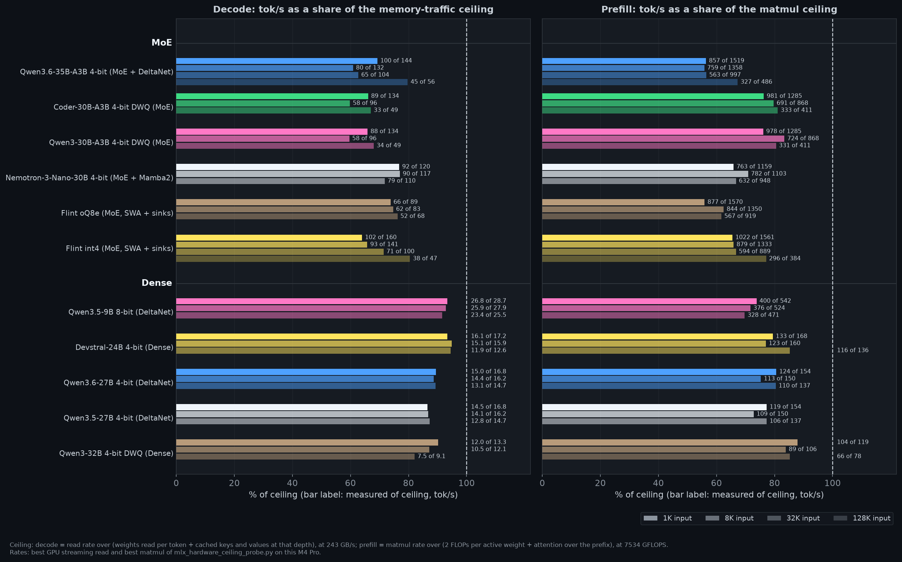
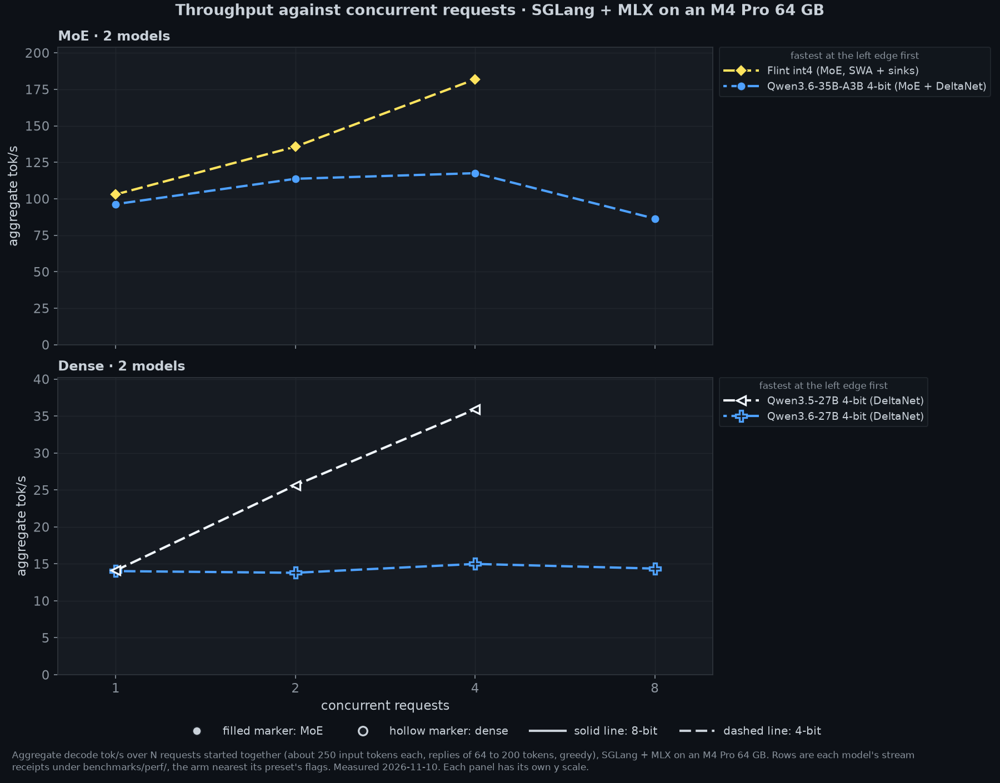
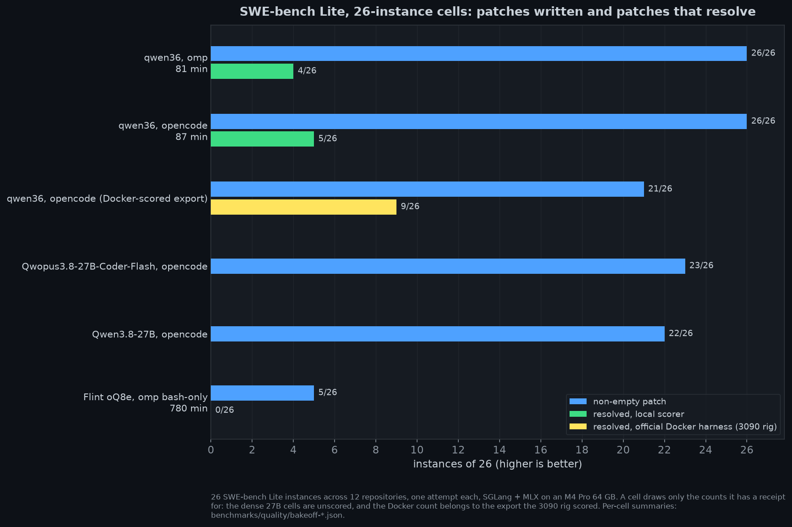

# Apple Silicon Inference: SGLang + MLX on M4 Pro

Long-context LLM inference on an Apple M4 Pro Mac mini (64 GB unified memory) with SGLang's
native MLX backend: **SGLang v0.5.23** (`297e54f`) + 31 patches ([patches/README.md](patches/README.md)).
The target workload is single-user agentic coding at long context (tool-call-heavy multi-turn
sessions over 10K–100K-token codebase prefixes), where decode speed at depth matters more
than peak batch throughput. Known issues are
[GitHub issues](https://github.com/mattbucci/m4-sglang-inference/issues?q=is%3Aissue+is%3Aopen+label%3Aknown-issue)
with the `known-issue` label; experiment specs and open work live in
[experiments/README.md](experiments/README.md).

## Results

- **`qwen36`** (Qwen3.6-35B-A3B MoE+DeltaNet+VL) is the primary model: 99.6 / 80.5 / 65.1 tok/s
  at 1K / 8K / 32K, codegen, vision and video STRONG, thinking VERIFIED.
- **256K single-user context validated**: 6/6 multi-needle recall at every rung to 245K realized
  tokens, 45 tok/s decode at 130K ([docs/long-context.md](docs/long-context.md)).
- **SWE-bench Lite**: qwen36 engages 26/26 sealed instances and resolves 9/26 = 34.6 % on the
  official Docker harness ([docs/agentic.md](docs/agentic.md)).
- **Against the hardware ceiling**: dense presets decode at 82–95 % of what the memory bus
  allows, MoE presets at 60–77 % ([docs/performance-ceiling.md](docs/performance-ceiling.md)).

### Single-user decode across the fleet


Single user, 64 output tokens, server-verified depth (`actual_input_tokens` == label), served
with `CTX=36000 MEM_FRAC=0.45 SGLANG_MLX_CACHE_LIMIT_GB=2 --disable-radix-cache`. These rows
are the regression baselines (`benchmarks/baselines.json`; `scripts/bench/bench_regression.sh <preset>`
compares a live server against them). [`generate_charts.py`](scripts/bench/generate_charts.py)
draws them plus the cold receipts for deeper input; a hatched bar stops short of 128K.

| Preset | Checkpoint (mlx-community) | Type | Wts | tok/s @1K / 8K / 32K | TTFT @32K | Context |
|--------|---------------------------|------|:---:|:--------------------:|:---------:|:--------|
| `qwen36` | `Qwen3.6-35B-A3B-4bit` | MoE+DeltaNet+VL | 17 GB | 99.6 / 80.5 / 65.1 | 58 s | **256K validated** |
| `coder-30b` | `Qwen3-Coder-30B-A3B-Instruct-4bit-DWQ` | MoE (3B active) | 16 GB | 88.6 / 57.7 / 33.0 | 98 s | 32K measured, 256K label |
| `qwen3-moe` | `Qwen3-30B-A3B-4bit-DWQ` | MoE (3B active) | 16 GB | 88.3 / 57.5 / 33.5 | 99 s | 32K measured, 256K label |
| `nemotron-30b` | `NVIDIA-Nemotron-3-Nano-30B-A3B-4bit` | NemotronH (Mamba2+Attn+MoE) | 17 GB | 91.8 / 90.2 / 78.8‡ | 48 s | 32K measured |
| `flint` | `flint-oQ8e` (`MODEL=RecursiveSI/flint-int4` for the fast 4-bit) | MoE 40B-A2.5B, SWA + sinks | 42 GB | 65.5 / 62.0 / 51.7 (int4: 101.9 / 93.2 / 72.3) | 54 s | 32K preset, 128K measured |
| `qwen35-9b-8bit` | `Qwen3.5-9B-MLX-8bit` | DeltaNet hybrid+VL | 10 GB | 26.8 / 25.9 / 23.4 | 100 s | 32K measured |
| `devstral` | `Devstral-Small-2-24B-Instruct-2512-4bit` | Dense+VL (Mistral3) | 14 GB | 16.1 / 15.1 / 11.9 | 282 s | 32K measured |
| `qwen36-27b` | `Qwen3.6-27B-4bit` | DeltaNet hybrid+VL | 14 GB | 15.0 / 14.4 / 13.1 | 298 s | 32K measured, 256K label |
| `qwen36-27b` + `MODEL=…/Qwen3.8-27B-4bit` | `Qwen3.8-27B-4bit` | DeltaNet hybrid+VL | 15 GB | 15.2 / 14.7 / 13.5‡ | 279 s | 32K measured, 131K served |
| `qwen36-27b` + `MODEL=mattbucci/Qwopus3.8-27B-Coder-Flash-MLX-4bit` | in-house build, published | DeltaNet hybrid+VL | 15 GB | 14.6 / 14.2 / 13.2 | 302 s | 32K measured, 131K served |
| `qwen35` | `Qwen3.5-27B-4bit` | DeltaNet hybrid+VL | 15 GB | 14.5 / 14.1 / 12.8 | 310 s | 32K measured, 256K label |
| `qwen3-32b` | `Qwen3-32B-4bit-DWQ` | Dense | 18 GB | 12.0 / 10.5 / 7.5† | 494 s | 32K at `MEM_FRAC=0.5` |

† The 0.45 pool caps `qwen3-32b` requests at 25,241 tokens, so its 32K point is served at
`MEM_FRAC=0.5`. ‡ Cold-sweep receipt on the preset defaults (`benchmarks/perf/2026-11-13/rerun/`).
**DeltaNet and Mamba2 hold decode flat at depth** (85–88 % of short-context speed at 32K)
while full-attention models halve or worse. Flint checkpoints and the published M4 Pro engine
targets: [docs/flint.md](docs/flint.md).

### Hardware ceiling, prefill and several streams



Decode is bound by the memory bus (243 GB/s measured), prefill by GPU arithmetic (7,534 GFLOPS).
Dense presets are on the wall; MoE presets carry 3–5 ms of fixed work per step that no byte
accounts for. Method, gap breakdown and levers: [docs/performance-ceiling.md](docs/performance-ceiling.md).



Aggregate tok/s at 1 / 2 / 4 / 8 streams on the preset defaults (`MAX_RUNNING=8`): coder-30b
and qwen3-moe 95 / 120 / 149 / 181, flint 68 / 91 / 127 / 151, nemotron-30b 93 / 109 / 117 / 92,
qwen36 100 / 104 / 107 / 103 (205 at 8 with batched decode, see Presets).

### SWE-bench Lite (26 sealed instances)



| Cell | Scaffold | Non-empty | Resolved | Wall |
|------|----------|:---------:|:--------:|-----:|
| **`qwen36`** | omp | 26/26 | local 4/26 | 81 min |
| Qwen3.8-27B (`qwen36-27b`) | omp | 24/26 | **local 6/26** | 476 min |
| `coder-30b` | omp | 25/26 | local 1/26 | 147 min |
| `qwen3-moe` | omp | 11/26 | local 1/26 | 58 min |
| `nemotron-30b` | omp | 10/26 | local 1/26 | 126 min |
| `flint` (oQ8e, bash-only) | omp | 5/26 | local 0/26 | 13 h |
| `qwen36` | opencode | 26/26 | local 5/26; **Docker 9/26 = 34.6 %** (21 scored) | 87 min |
| Qwopus3.8-27B-Coder-Flash | opencode | 23/26 | awaits Docker scoring | 9–10 h |
| Qwen3.8-27B | opencode | 22/26 | awaits Docker scoring | 9–10 h |

Qwen3.8-27B resolves the most on the local scorer at six times qwen36's wall (1800 s cap against
900 s); the scorer cannot build 7–8 of the 26 environments, so local counts are a floor.
One scaffold lane, omp 18.12.2 (the 3090's pin); harness variants are within noise, so the
opencode cells stay comparable. The Docker score comes from the 3090 rig's harness. Sealed
harness, per-cell notes and the model ranking: [docs/agentic.md](docs/agentic.md).

### Quality

| Preset | MMLU | HumanEval | LAB-Bench | Needle | codegen | vision | video | thinking |
|--------|:----:|:---------:|:---------:|:------:|:-------:|:------:|:-----:|:--------:|
| `qwen36` | 85 | 85 | 32.6 | 100 | **STRONG** | **STRONG** | **STRONG** | **VERIFIED** |
| `qwen36-27b` (Qwen3.6-27B) | 89 | 100 | 35.4 | 100 | **STRONG** | **STRONG** | **STRONG** | **VERIFIED** |
| `qwen36-27b` + Qwen3.8-27B | 86 | 90 | 43.4 | 100 | **STRONG** | **STRONG** | **STRONG** | **VERIFIED** |
| `qwen36-27b` + Qwopus3.8-27B-Coder-Flash | 84 | 90 | 40.0 | 100 | **STRONG** | **STRONG** | **STRONG** | **VERIFIED** |
| `coder-30b` | 84 | 100 | 32.0 | 100 | **STRONG** | n/a | n/a | validate gate |
| `qwen3-moe` | 85 | 75 | 29.7 | 100 | **STRONG** | n/a | n/a | validate gate |
| `flint` (oQ8e) | 76 | 75 | 5.1 | 100 | **STRONG** | n/a | n/a | **VERIFIED** |
| `nemotron-30b` | 80 | 10 | 13.1 | 100 | **STRONG** | n/a | n/a | **VERIFIED** |
| `qwen35` | 90 | 100 | 53/125 | 100 | **STRONG** | **STRONG** | PARTIAL | **VERIFIED** |
| `qwen35-9b-8bit` | 81 | 80 | 52/150 | 100 | **STRONG** | **STRONG** | **STRONG** | validate gate |
| `qwen3-32b` | 90 | 95 | 33.1 | 100 | **STRONG** | n/a | n/a | validate gate |
| `devstral` | 71 | 55 | 34.3 | 100 | **STRONG** | **STRONG** | PARTIAL | n/a |

Percent; MMLU 100 questions, HumanEval 20 tasks, LAB-Bench 7 categories x 25, needle to 16K
(`benchmarks/quality/`). Probes run with the radix cache on (`benchmarks/quality/probe-trio/`).
Qwen3.8-27B, Qwopus3.8-27B-Coder-Flash, Qwen3.6-27B and Qwen3.5-9B-8bit chat templates ignore
`enable_thinking` (thinking always on). Checkpoint audits and the in-house 4-bit builds:
[docs/quality.md](docs/quality.md).

## Presets

`[OK]` presets pass their gates (`validate_capabilities.py`, probe trio, chat-template check);
`[WIP]` presets do not boot.

| Preset | Model | Notes |
|--------|-------|-------|
| `qwen36` [OK] | Qwen3.6-35B-A3B MoE+DeltaNet+VL | primary agentic model; `MODEL=~/AI/models/Qwen3.6-35B-A3B-4bit-inhouse` for the in-house build |
| `coder-30b` [OK] | Qwen3-Coder-30B-A3B-DWQ MoE | fastest decode, direct chat-completion codegen |
| `qwen3-moe` [OK] | Qwen3-30B-A3B-DWQ MoE | |
| `qwen3-32b` [OK] | Qwen3-32B-DWQ dense | 32K ceiling (dense attention) |
| `qwen35` [OK] | Qwen3.5-27B DeltaNet hybrid+VL | |
| `qwen35-9b-8bit` [OK] | Qwen3.5-9B 8-bit | 10 GB resident; thinking always on |
| `qwen36-27b` [OK] | Qwen3.6-27B dense DeltaNet+VL | `MODEL=mlx-community/Qwen3.8-27B-4bit` serves Qwen3.8-27B (validator 4/4); `MODEL=mattbucci/Qwopus3.8-27B-Coder-Flash-MLX-4bit` serves the Qwopus coding fine-tune (in-house MLX build, validator 3/3); thinking always on |
| `devstral` [OK] | Devstral 24B + image VLM | custom chat template (`scripts/devstral_chat_template.jinja`) |
| `nemotron-30b` [OK] | NemotronH Mamba2+Attn+MoE | `nemotron_3` reasoning parser |
| `flint` [OK] | Recursive Flint 40B-A2.5B coding-agent MoE | oQ8e default; `MODEL=RecursiveSI/flint-int4` decodes 56 % faster in 20 GB less, also oQ6e / oQ4e; [docs/flint.md](docs/flint.md) |
| `gemma4`, `gemma4-31b` [WIP] | Gemma 4 26B MoE / 31B dense | boot failure: mlx-vlm Gemma 4 attention not recognised by the MLX attention contract |
| `coder-next` | Qwen3-Coder-Next-80B | infeasible on 64 GB |
| `smol-docling` | 256M VLM | smoke test only |

Every preset sets `--mlx-enable-sampling` (per-request temperature / top-p / top-k / min-p;
greedy stays bit-stable argmax; a request with no sampling fields takes the checkpoint's
generation config, or the preset's `SAMPLING_FALLBACK` where the checkpoint ships none:
`qwen3-32b`, `qwen3-moe`, `qwen35-9b-8bit`). Hybrid presets and `flint` run the radix cache
and keep the pipelined decode loop under it (patch 028, +5–25 % decode tok/s; `SGLANG_MLX_HYBRID_OVERLAP=0` restores the normal
loop). `launch.sh` knobs: `CTX`, `MEM_FRAC`,
`CHUNKED`, `MAX_RUNNING`, `MAX_TOTAL_TOKENS`, `MODEL`, `EXTRA_ARGS`, `--kv-cache` (accepted,
inert on this backend: KV stays bf16).

Several streams on the Qwen3.5/3.6 presets: `SGLANG_MLX_BATCH_MROPE_DECODE=1` (patch 035, the
`qwen35` default) decodes a step of several requests as one forward. Aggregate tok/s at
1 / 2 / 4 / 8 streams with `MAX_RUNNING=8`: qwen36 101 / 142 / 180 / 205 (100 / 104 / 108 / 104 with
one forward per request, the preset default), qwen36-27b 14 / 26 / 36 / 37 (14 / 14 / 15 / 14); a single stream
does not move. With the flag a greedy request's text depends on which of its steps had
company (one row and several rows round differently in MLX); `=0` keeps solo text under load.
Receipts: `benchmarks/perf/2026-11-10/concurrent/VERDICT.md`, `benchmarks/perf/2026-11-12/streams/`.

## Quick start

```bash
./scripts/setup.sh                          # conda env, SGLang v0.5.23, MLX deps, 31 patches + gates
source scripts/common.sh                    # SGLANG_USE_MLX=1 and the MLX env; always before launching

./scripts/launch.sh qwen36                  # PRIMARY (any preset from the table above)

# Long-context (OOM guard mandatory for ≥32K: macOS has no OOM killer)
bash scripts/common/oom_guard.sh &
CTX=140000 MEM_FRAC=0.5 CHUNKED=1024 EXTRA_ARGS="--disable-radix-cache" bash scripts/launch.sh qwen36

# Agentic coding (qwen36 on the omp scaffold, thinking off via the proxy)
bash evals/swebench/vendor_omp.sh           # sha-pinned omp 18.12.2 into evals/swebench/bin/
PRESET=qwen36 INSTANCES=3 bash evals/swebench/smoke.sh   # server + proxy + sealed rollout
python evals/swebench/no_thinking_proxy.py &   # manual: scaffold → :23335 → SGLang :23334

# Capability gates (server up on PORT 23334)
python scripts/eval/validate_capabilities.py --port 23334   # basic + thinking gate
python scripts/eval/probe_thinking.py        --port 23334   # content-aware reasoning probe
python scripts/eval/probe_vision.py          --port 23334   # content-aware image probe
python scripts/eval/probe_codegen.py         --port 23334   # 2-task / 8-test codegen probe
bash   scripts/eval/probe_all.sh                            # probe trio across presets

# Pre-launch checkpoint audits (no server)
python scripts/eval/check_mlx_quant_scales.py   <repo-or-path>
python scripts/eval/audit_mlx_quant_metadata.py
python scripts/eval/validate_chat_template.py --model <path>

# Benchmarks and evals
scripts/bench/bench_regression.sh qwen36                    # decode tripwire vs benchmarks/baselines.json
bash   scripts/bench/bench_256k_all.sh                      # long-context sweep (guard first)
python scripts/eval/eval_and_chart.py --run --port 23334 --tag "qwen36"   # MMLU / HE / LAB-Bench / needle
python3 .github/actions/docs-check/docs_check.py --root .   # docs rules (README skeleton, sizes, dates)
```

Memory rules: never raise `MEM_FRAC` above the 0.7 default (it is a fraction of total system
RAM; 0.85 has hard-locked the box), go down to 0.4–0.5 for 32K+ work, and run the OOM guard
(it pkills the server when `kern.memorystatus_level` reports under 8 GB available).

Prerequisites: Apple Silicon Mac with ≥ 64 GB unified memory, macOS 26+ (Tahoe), Xcode CLT,
Python 3.12, ~200 GB disk for models. Reference rig: Mac mini (Mac16,11), M4 Pro 14-core CPU /
20-core GPU, 64 GB LPDDR5 (~273 GB/s), macOS 26.2.

## Stack

| Component | Version |
|-----------|---------|
| SGLang | **v0.5.23** (`297e54f`) + 31 patches |
| MLX | 0.32.4 |
| mlx-lm | git `736ab0d` (0.32.3.dev, carries the Flint model) |
| mlx-vlm | 0.6.5 |
| PyTorch | 2.13.0 (MPS) |
| transformers | 5.19.0 |
| Python | 3.12 |

Manual install, equivalent to `scripts/setup.sh`:

```bash
conda create -y -n sglang-0523 python=3.12 && conda activate sglang-0523
conda install -y -c conda-forge "rust>=1.88"   # SGLang builds a Rust extension at install time
git clone --depth 1 --branch v0.5.23 https://github.com/sgl-project/sglang.git components/sglang
cd components/sglang
for p in ../../patches/0[0-9][0-9]-*.patch; do git apply "$p"; done
cd python && cp pyproject_other.toml pyproject.toml
pip install -e ".[srt_mps]"
pip install "mlx-lm @ git+https://github.com/ml-explore/mlx-lm.git@736ab0d8c1d0edc79c3d798044fe6904e2fa23be"   # Flint model
pip install "mlx-vlm==0.6.5" --no-deps    # --no-deps keeps SGLang's transformers / mlx-lm pins
```

**Patches** (rationale, gates and per-patch tests in [patches/README.md](patches/README.md)):
002 MPS defaults + `--kv-cache-dtype` aliases · 003 MLX quantization-config shape ·
005 attention-wrapper varargs · 007 MPS tensor shim + multimodal shm · 008 VLM/hybrid
integration (mlx_vlm loader, radix-for-hybrids, NemotronH, MLX buffer-cache cap) ·
014 HF processor fixes · 015 attention-cache pre-sizing · 018 auxiliary-slot admission
eviction · 019 Flint support · 020 last-token prefill logits · 021 sliding-window prefix
snapshots · 022 pool-backed cache append · 023 release finished requests · 024 wired-limit
env (`SGLANG_MLX_WIRED_LIMIT_GB`, default 0: the IOGPUFamily panic mitigation) ·
025 DiffusionGemma structured reads (CUDA/ROCm hosts) · 026 continuation-chunk DeltaNet
tracking · 027 incremental chat-prompt tokenizer + lazy multimodal decode-back
(`SGLANG_INCREMENTAL_TOKENIZE`, from the 3090's patch 072) · 028 pipelined decode loop
under the radix cache · 029 SDPA block ladder (opt-in) · 030–032 fused decode launches
(on in `qwen36`) · 033–035 mRoPE prefix-hit positions, per-request delta, batched decode ·
036 windowed lookahead view · 037 fused Flint MoE block (on in `flint`) · 038 decode
submission in parts (5 in `flint` and `qwen36`) · 039 scheduled snapshot evaluation ·
040 prompt-lookup drafts for a lone request on a dense checkpoint (opt-in) · 041 sampling
defaults for a checkpoint with no generation config.

**Gate protocol (publish precondition):** every setup run, and any stack change before its
numbers are published, must pass `scripts/test_patch_gates.sh` (pristine replay +
byte-identity + double-apply rejection; `setup.sh` runs it and aborts on failure),
`scripts/eval/import_smoke.py` (eager import of every patch-touched module + load-bearing
symbols), and the behavioral probe gate (`PRESETS="devstral qwen36" scripts/eval/probe_all.sh`;
verdicts must match `benchmarks/quality/probe-trio/`, and a STRONG→FAIL flip is a
stop-and-investigate finding). Receipts: `benchmarks/patch-gates/`. Patches never go
upstream; they live in `patches/` and the local component tree only.

Sister rigs on the same SGLang stack share eval scripts, calibration findings and
chat-template fixes: the 3090 pair (NVIDIA, AWQ_Marlin) and the R9700 pair (AMD RDNA4, ROCm).

## Repo map

```
patches/                    # 31 numbered patches; see patches/README.md
docs/                       # agentic, flint, long-context, performance-ceiling, quality
experiments/                # Experiment specs and the open queue
benchmarks/                 # Per-model JSON, regression baselines, dated receipts
  quality/                  #   MMLU / HumanEval / needle / probe-trio verdicts / fidelity
  <slug>/                   #   throughput + long-context sweeps
evals/swebench/             # Sealed agentic-coding harness + dated run receipts
scripts/
  launch.sh                 # Unified launcher: launch.sh <preset>
  common.sh                 # Shared MLX env setup
  setup.sh                  # Full setup (env, SGLang clone, patches, gates)
  common/oom_guard.sh       # MANDATORY for ≥32K work
  bench/                    # bench_long_context.py, bench_256k_all.sh, bench_regression.sh
  eval/                     # validate_capabilities, probes, eval_and_chart, audits, patch unit tests
  quantize/                 # in-house 4-bit converter
components/sglang/          # SGLang checkout + applied patches (cloned by setup.sh)
.github/actions/docs-check/ # shared docs rules for the three rig repos
```
