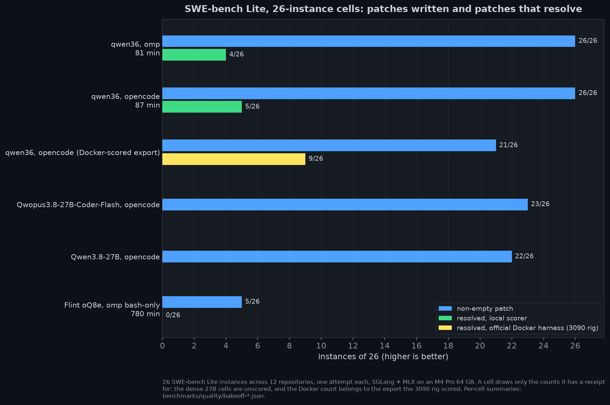

# Agentic coding (SWE-bench Lite)

The 26-instance sealed cells behind the README chart. Cell summaries:
`benchmarks/quality/bakeoff-*.json` (`evals/swebench/aggregate_bakeoff.py`).

**`qwen36` is the only configuration that completes the agentic loop on M4 reproducibly
across all 12 ecosystems in the 26-instance test set.**

- **Patch engagement 26/26** (`evals/swebench/runs/qwen36-26inst-p023-2026-10-31/`): a
  non-empty patch targeting the canonical issue file on every instance.
- **Resolved 9/26 = 34.6%** on the official Docker harness, scored on the 3090 rig
  ([`exports/qwen36-docker-summary.json`](../evals/swebench/exports/qwen36-docker-summary.json));
  above the 14–30% band typical of ~30B models on SWE-bench Lite.
- **Harness:** one scaffold lane, omp (oh-my-pi) 18.12.2, the 3090's pin; the 3090's
  scaffold bake-off puts every opencode / pi-family pair within noise (McNemar ties on 300
  isolated instances), so harness variants are not a lever. The M4 validation cell agrees:
  qwen36 under omp engages 26/26 with 25 patches on the file the opencode cell patched, 0
  timeouts, 99 min against 87, and the local scorer resolves 6/26 against 5/26 for the
  opencode lane (`evals/swebench/runs/qwen36-26inst-omp-2026-11-08/`). The omp cell on
  the fused-decode defaults (`evals/swebench/runs/qwen36-omp-final-26inst-2026-11-12/`): 26/26,
  local scorer 4/26, 81 min, served decode 72 tok/s pooled over 1124 turns. opencode
  stays selectable (`SCAFFOLD=opencode`) to reproduce the archived cells, which ran on it.
- **Sealed harness:** web tools off, the scaffold and its bash children under a localhost-only
  network sandbox, ancestor-only checkout (no branch, tag or commit past the base commit);
  `evals/swebench/audit_rollouts.py` scans the archive for leak channels, and no scored
  prediction came from a session that saw the fix. Under the seal Qwen3.8-27B writes the
  upstream change on all three smoke instances in 4–8 min each, the Qwopus3.8-27B-Coder-Flash
  build patches the same three (two the upstream change, one its regex half;
  `evals/swebench/runs/qwopus38-27b-coder-flash-sealed-131k-2026-11-02/`), and Flint bash-only
  at 64K engages 5/26 with every instance at the 1800 s cap
  ([evals/swebench/README.md](../evals/swebench/README.md)).
- **Dense 27B comparators on the same 26 instances, sealed, 1800 s cap:** the
  Qwopus3.8-27B-Coder-Flash build engages 23/26 (22 on the canonical file) and stock
  Qwen3.8-27B 22/26 (21), against qwen36's 26/26 at a 900 s cap; the two dense builds trade
  instances (stock patches django-10924 and pytest-11148 where Qwopus times out empty; Qwopus
  patches xarray-3364, pylint-6506 and sphinx-10451 where stock does), and each cell takes
  9–10 h where qwen36's took 87 min at 13 vs 57 tok/s decode
  (`evals/swebench/runs/{qwopus38-27b-coder-flash,qwen38-27b-community}-26inst-sealed-2026-11-02/`;
  both exports await Docker scoring).
- **Calibration:** the engagement-to-resolve gap is the model characterization. qwen36
  patches look right (correct file, valid syntax, usually no regressions) but miss the
  semantic intent in most cases. Trust it for first-pass exploration; verify with tests.

| Rank | Preset | Why | Agentic verdict |
|:----:|--------|-----|-----------------|
| **1** | **`qwen36`** (Qwen3.6-35B-A3B-4bit) | Only model to complete the agentic loop on M4 in a 9-model bake-off; MoE 3B-active decode speed appears load-bearing. Use with [`no_thinking_proxy`](../evals/swebench/no_thinking_proxy.py). | engagement 26/26; **Docker 9/26 = 34.6%** |
| 2 | `qwen36-27b` + Qwopus3.8-27B-Coder-Flash or stock Qwen3.8-27B | Dense DeltaNet 27B at 13 tok/s with thinking always on: finds the right file nearly as often as qwen36 but half the instances hit a 30-minute cap; the coding fine-tune and its base trade instances rather than one dominating. | engagement 23/26 (Qwopus), 22/26 (stock); Docker scoring pending |
| 3 | `qwen35` (Qwen3.5-27B-4bit) | Capability-equivalent to qwen36 at ~15× the wall time: same patches where qwen36 succeeds, same misses where it fails. | SWE-bench Lite 1/3 |
| 4 | `flint` (Recursive Flint 40B-A2.5B oQ8e) | Trained for coding agents, but under omp it never ends its turn: 26-instance sealed cell, bash-only at 64K, 5/26 non-empty with every instance at the 1800 s cap (13 h), 0/26 on the local scorer; on 14 of the 21 empties it never attempts an edit. | engagement 5/26; local 0/26 |
| 5 | `coder-30b` (Qwen3-Coder-30B-A3B-DWQ) | Best static HumanEval (95) and decode speed; use for direct chat-completion codegen. Under opencode the loop gives up after one `glob`. | 0 edits |
| 6 | `gemma4-31b` | Top MMLU (92). Blocked at boot; zero tokens under opencode tool-call prompts when it did run. | 0 tool calls |

Session endurance, the append-turn cost and the radix prefix cache on hybrids:
[docs/long-context.md](long-context.md).
