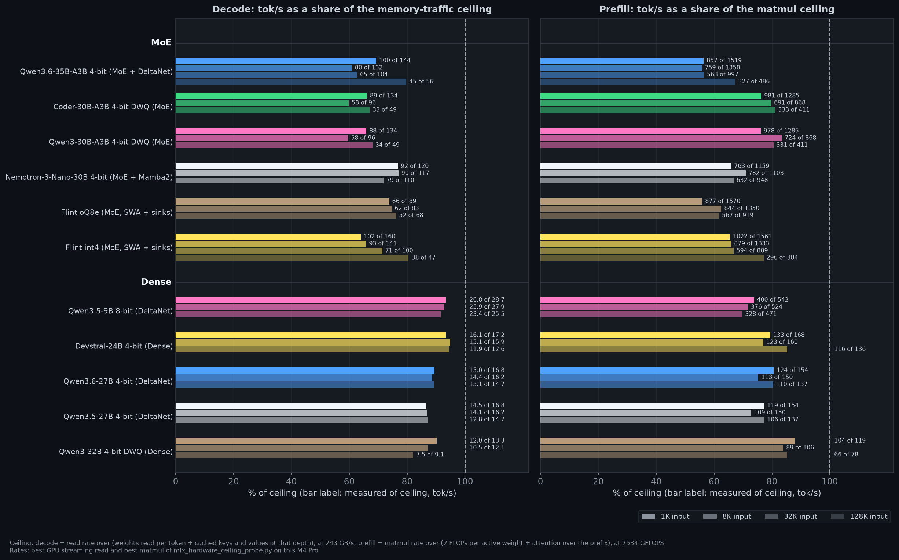

# Performance ceiling

What the M4 Pro allows, where each preset stands against it, and what sits in the gap.
Receipts: `benchmarks/perf/2026-11-13/ceiling/` (hardware probe and report), chart
`benchmarks/all_models_ceiling.png`.

## Two limits

| Limit | Binds | Measured on this machine | How |
|---|---|---|---|
| Memory bus | decode | 243 GB/s GPU streaming read (CPU, 10 threads: 240 GB/s; nominal 273 GB/s) | `mlx_hardware_ceiling_probe.py`, `bandwidth` rows |
| GPU arithmetic | prefill | 7,534 GFLOPS bf16 matmul (fp32: 6,660; 4-bit quantized matmul at 4,096 rows: 5,899) | same probe, `compute` rows |

**Decode** streams every weight a token's matmuls touch plus every cached key and value its
attention layers read, once per token. The ceiling at depth d is the bus rate over
(weight bytes per token + KV bytes at d). **Prefill** reuses each weight across the rows of a
chunk, so it is bound by arithmetic: the ceiling is the matmul rate over (2 FLOPs per active
weight + attention over the prefix). Bytes and FLOPs come from the safetensors headers and
`config.json`; for MoE only the routed top-k experts count.

The ceiling leaves out recurrent state (DeltaNet, Mamba2), activations, sampling and the host,
so it is optimistic: a preset at 90 % is on the wall. Regenerate with
`python scripts/bench/ceiling_report.py --hardware <probe receipts> --out <json> --chart <png>`.

## Where each preset stands

Measured tok/s, ceiling, and share. Decode and prefill rungs are the ones the fleet charts draw.

| Preset | Weights read per token | Decode 1K | Decode 32K | Prefill 1K | Prefill 32K |
|---|---:|---:|---:|---:|---:|
| qwen36 | 1.67 GB | 99.6 of 144 (69 %) | 65.1 of 104 (63 %) | 857 of 1,519 (56 %) | 563 of 997 (56 %) |
| coder-30b | 1.71 GB | 88.6 of 134 (66 %) | 33.0 of 49 (67 %) | 981 of 1,285 (76 %) | 333 of 411 (81 %) |
| qwen3-moe | 1.71 GB | 88.3 of 134 (66 %) | 33.5 of 49 (68 %) | 978 of 1,285 (76 %) | 331 of 411 (80 %) |
| nemotron-30b | 2.03 GB | 91.8 of 120 (77 %) | 78.8 of 110 (72 %) | 763 of 1,159 (66 %) | 632 of 948 (67 %) |
| flint (oQ8e) | 2.67 GB | 65.5 of 89 (74 %) | 51.7 of 68 (76 %) | 877 of 1,570 (56 %) | 567 of 919 (62 %) |
| flint (int4) | 1.45 GB | 102.5 of 160 (64 %) | 71.4 of 100 (71 %) | 1,022 of 1,561 (66 %) | 594 of 889 (67 %) |
| qwen35-9b-8bit | 8.43 GB | 26.8 of 28.7 (93 %) | 23.4 of 25.5 (92 %) | 400 of 542 (74 %) | 328 of 471 (70 %) |
| devstral | 13.9 GB | 16.1 of 17.2 (93 %) | 11.9 of 12.6 (94 %) | 133 of 168 (79 %) | 116 of 136 (85 %) |
| qwen36-27b | 14.4 GB | 15.0 of 16.8 (89 %) | 13.1 of 14.7 (89 %) | 124 of 154 (81 %) | 110 of 137 (80 %) |
| qwen35 | 14.4 GB | 14.5 of 16.8 (86 %) | 12.8 of 14.7 (87 %) | 119 of 154 (77 %) | 106 of 137 (77 %) |
| qwen3-32b | 18.0 GB | 12.0 of 13.3 (90 %) | 7.5 of 9.1 (82 %) | 104 of 119 (88 %) | 66 of 78 (85 %) |

At 130K qwen36 decodes 44.7 of 56 (80 %) and Flint int4 37.5 of 47 (80 %): the KV read
dominates the step and the fixed costs below shrink in proportion.

## Where the gap is

**Dense decode is on the memory wall (82 to 95 %).** No scheduling or kernel work moves it.
Only fewer bytes per token do: a lower-bit recipe, or a drafter that verifies several tokens
on one pass over the weights.

**MoE decode carries a fixed cost per step (60 to 77 %).** A step reads 1.5 to 2.7 GB, which
the bus moves in 6 to 11 ms, and spends another 3 to 5 ms that no byte accounts for. On qwen36
the folded step is 10.15 ms against 7.9 to 8.2 ms of bytes, built from about 1,850 GPU
primitives at 2 to 5 µs each plus 2.0 ms of host graph build that overlaps the GPU. By block:
GatedDeltaNet 3.74 ms, the MoE block 4.01 ms, attention 0.95 ms at short depth and 2.14 ms at
8K, the head 1.29 ms on its read. Small matrices also read slower than the bus: one-row
quantized matmuls on 2,048-wide weights stream at 123 to 162 GB/s in isolation against
169 to 179 GB/s on 4,096 and 8,192-wide ones. Detail: `benchmarks/perf/2026-11-10/micro/VERDICT.md`.

**Mid-depth attention (8K to 32K) is the weakest decode rung on the Qwen3 MoE pair (60 %).**
48 full-attention layers with 4 KV heads read 98 KB per context token, five times qwen36,
and the attention kernel reads the cache at a lower rate than a plain stream.

**Prefill is arithmetic-bound and the presets reach 56 to 88 % of the best matmul rate.**
Dense presets sit at 77 to 88 %; what is left is the quantized kernel (78 % of the bf16
rate in isolation) and attention. qwen36 and Flint oQ8e sit lowest at 56 %: the recurrent
layers and routed experts run many small launches per chunk instead of a few large matmuls.

**Several streams.** Decode is bound by reads of weights that streams share, so batching is
where throughput above the single-stream ceiling comes from: coder-30b reaches 181 tok/s
aggregate at 8 streams against a 134 tok/s single-stream ceiling. qwen36 stays flat near
104 tok/s on the preset default and reaches 205 with `SGLANG_MLX_BATCH_MROPE_DECODE=1`.

## Against other engines on this chip

Flint int4 is the one checkpoint with published M4 Pro numbers from other engines.

| Engine | Decode 1K | Share of ceiling | Decode 128K | Share of ceiling |
|---|---:|---:|---:|---:|
| Kapitsa | 124.3 | 78 % | 45.7 | 98 % |
| rec | 126.5 | 79 % | 35.2 | 76 % |
| This stack | 102.5 | 64 % | 37.5 | 80 % |
| llama.cpp | 77.5 | 48 % | 23.8 | 51 % |

The best published short-context decode is 79 % of the ceiling, so about 2 ms of this
stack's fixed step cost is known to be removable and the last 20 % is unclaimed by anyone.
Kapitsa's deep decode shows the attention read can run at the bus rate. Prefill here is 93 to
97 % of Kapitsa's. Sources: [Kapitsa pull 290](https://github.com/nace-ai/kapitsa/pull/290),
[Kapitsa pull 286](https://github.com/nace-ai/kapitsa/pull/286), [rec](https://github.com/recursive-oss/rec).

## What would move each number

| Lever | Bound it attacks | Estimated size |
|---|---|---|
| Fewer launches per MoE step (fold routing, DeltaNet front, norms) | fixed step cost | up to 15 % decode on MoE at short depth |
| Single-query attention kernel reading KV at the bus rate | deep decode | up to 20 % at 128K on Flint, less on qwen36 |
| Batched decode on by default for hybrid presets | shared weight reads | 2x aggregate at 8 streams on qwen36 |
| Drafter for the dense 27B | bytes per token | the only route past 16.8 tok/s |
| Larger fused launches in recurrent and expert prefill | arithmetic utilisation | qwen36 prefill from 56 % toward the 80 % the Qwen3 MoE pair reaches |
